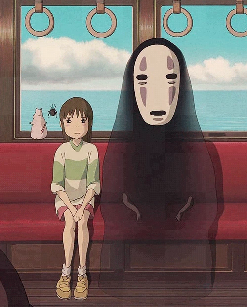

用几个关键词形容十月：国庆、千与千寻、劳累需求、九寨沟、努力学习。经历了很多事，明白自己需要承担的责任，也跟身边人学到了很多，“三人行，必有我师” 此言非虚。

---

国庆七天假期回了趟山东老家。赶飞机的出租车上，路上经过《功夫足球》的取景地——甜在心包子铺。这部电影我看了至少三遍，虽然剧情有点俗套，但呈现效果还是很好的。那个时候赵薇很青涩，星爷也还年轻。前段时间又拍了一部功夫女足（好像是叫这个名字），风评一般。

国庆假期后两天去赣州参加紫薇同学的回门宴。只待了短短两天，我对赣州的印象是：微辣也是辣、米粉达人、生活成本低（饮食、住宿、打车都很实惠）、十月初穿秋衣的含金量、不是江西省会、公园逛一逛很舒服。

---

之前毛毛来找我玩的时候说，“深圳就是一个巨大的汤屋”，促使我二刷了《千与千寻》。第一次看的时候应该是在大学，说实话，象牙塔里的我没看懂，少不更事啊！每天总是上课、写作业，过得像高三一般，着实是有些浪费了青春年华。我现在来回忆下二刷的印象：名字和自我、贪婪、随波逐流的无脸男、汤屋和工作、初心不改。强如钱婆婆，她的魔法也会很快消失。所以，外界的影响只是暂时的。你想要的人生，是自己决定的。曾经发生的事不可能忘记，只是暂时想不起来。发生过的一切都是有意义的，只不过你不会全部清晰记得。就像文件还在硬盘里，但是指针丢了...

看完了 B 站 up 主 “42手册” 对《千与千寻》、《罗小黑战记》的每一集拉片。细节已然说不上来，但隐约记得：主体颜色与背景色的呼应融合、人物运动朝向、镜头倾斜带来的不安感、画面布局与留白等等。还是颇有收获。

---

这个月有个超级恶心的工作需求，其实严格意义上不算是这个月，因为该需求从 9 月份就开始了，中间跨越国庆假期，前后做了一个月（很难想象 AI 时代，一个需求要做这么久）。导致 10.8 第一天上班的时候，我心里还是一直忐忑、抗拒、想要逃避。不过事后想想，它也算助力我成为工作中的老油条。嗟乎，需求已过，独留一些复盘而已： 1. 产品如果没想明白，就逼着他们想明白；2. 方案实施前，所有顾虑、潜在卡点必须全部讲明白，方案实施中遇到的问题同理；3. 尽量避开这种无聊的需求。

十月下旬，交付完成那个需求后，我急需一场心灵疗愈。正正好好公司的旅游团建时间定在 10.23，完美卡点。于是便是为期 4 天非常舒坦的九寨沟之旅，具体的行程已经单独成文。

---

八月底开始转为全栈工程师，至今已经两个月了。每个月都不敢懈怠：补前端的课、记录后端的踩坑、跟进 Agent 最佳实践。一个月的学习，关键词有很多：next.js、nest.js、软链接&硬链接&Copy-on-write、Ajax、Lua 脚本、函数式编程、BT 种子、Electron 应用打包&热更新、Browser use 原理、web 风控攻防层级... 

虽然写代码全靠 vibe coding，但一名合格的工程师不能让自己陷入黑盒。更何况，很多时候了解原理能够加快效率、选择最优解。所以持续进步是我们的期许，终身学习是我们的浪漫。Anthropic 工程经理有篇博客《Hunger beats tenure》讲“渴望胜过资历”：AI 抹平了老员工靠年限积累的经验优势，新人应当利用鲜活视角锚定业务痛点，通过 AI 做出 Demo 快速验证。因此他们不再需要靠熬资历、走审批来换取话语权。

---

说实话，天天和 AI 打交道，我已经审美疲劳了。每天被 AI 味十足的文字包围——别人给我 AI 写的文档，我也用 AI 写文档给别人看——感觉自己的文笔都退化了，虽然这个的前提是我有文笔。所以一定花点时间自己一个字一个字手敲完这篇文章。

