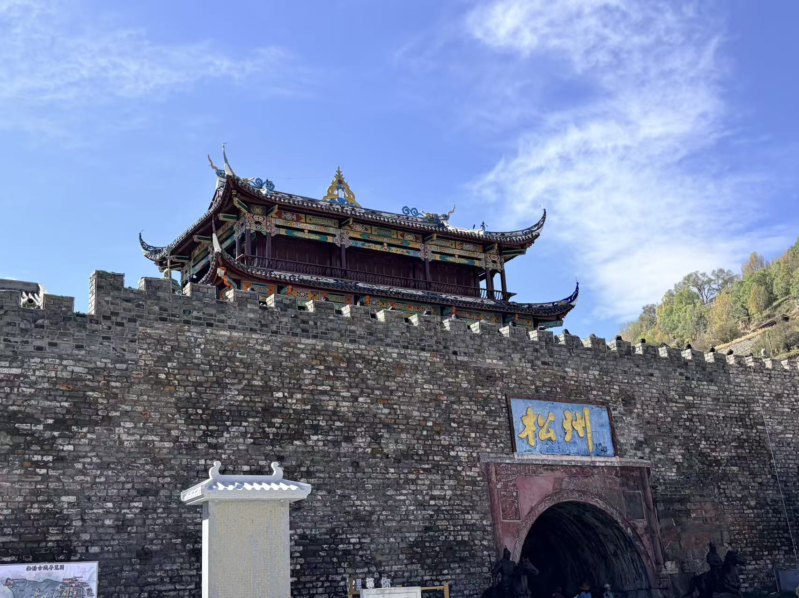
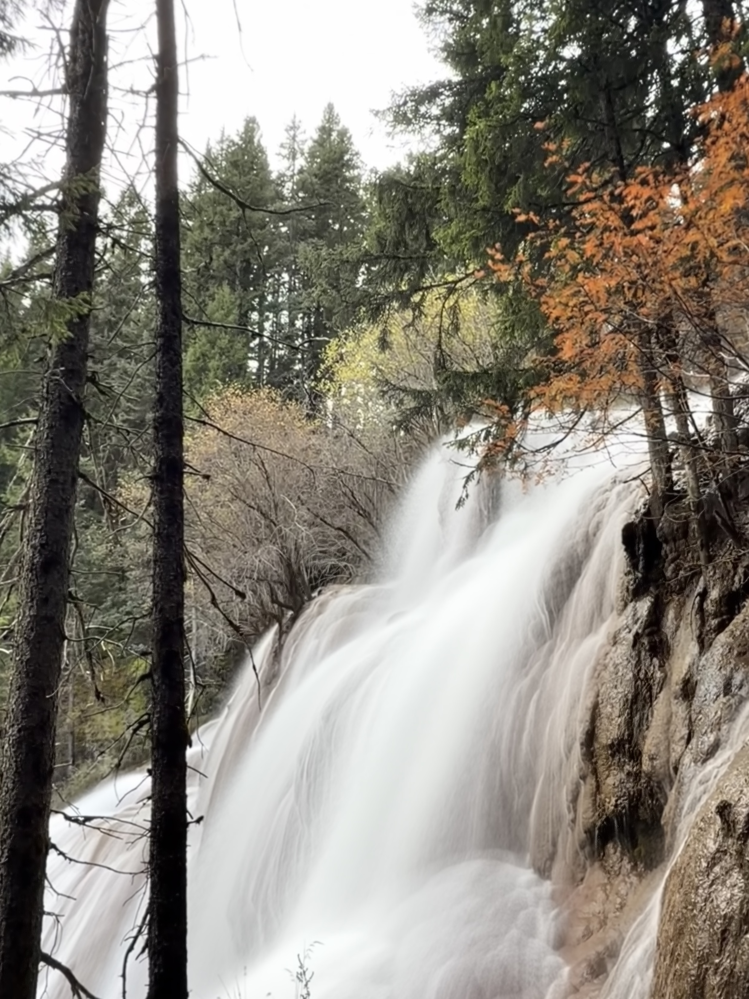
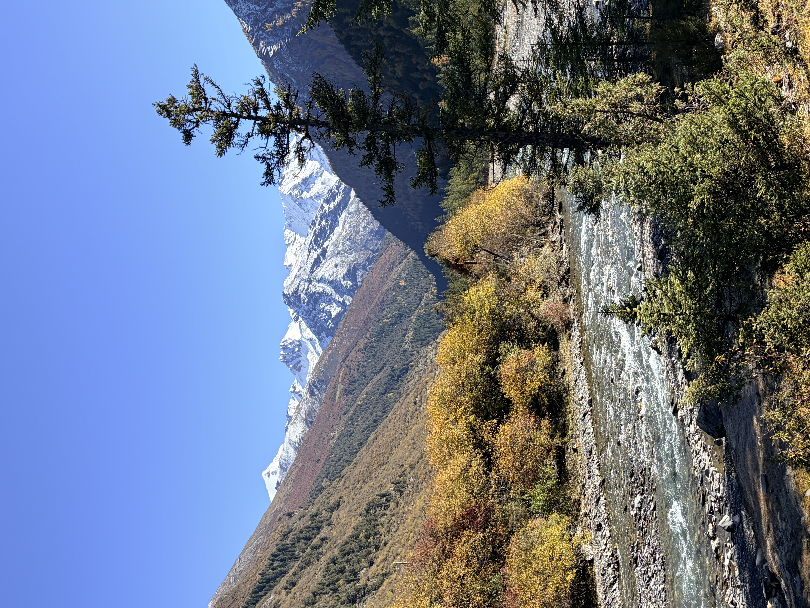
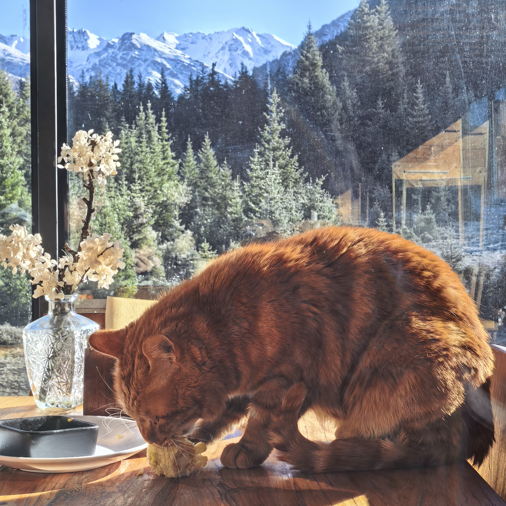
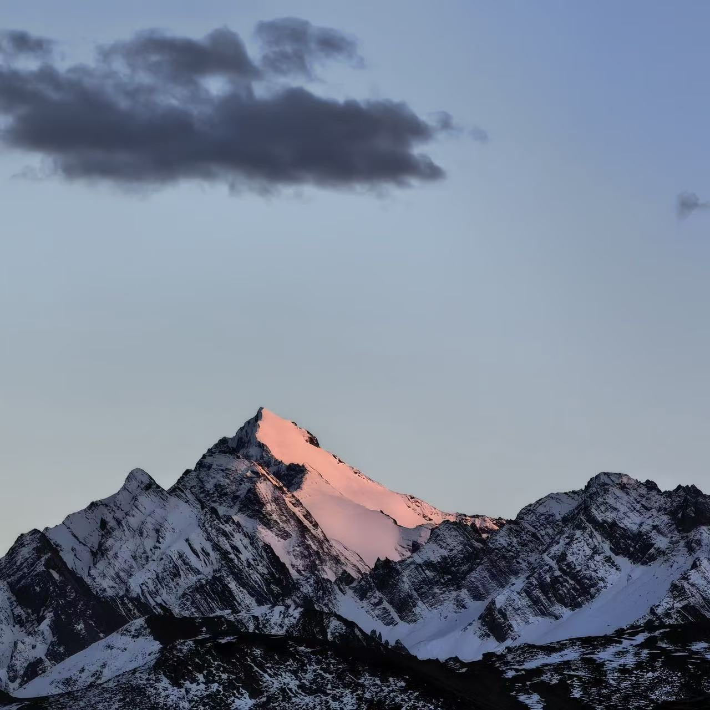
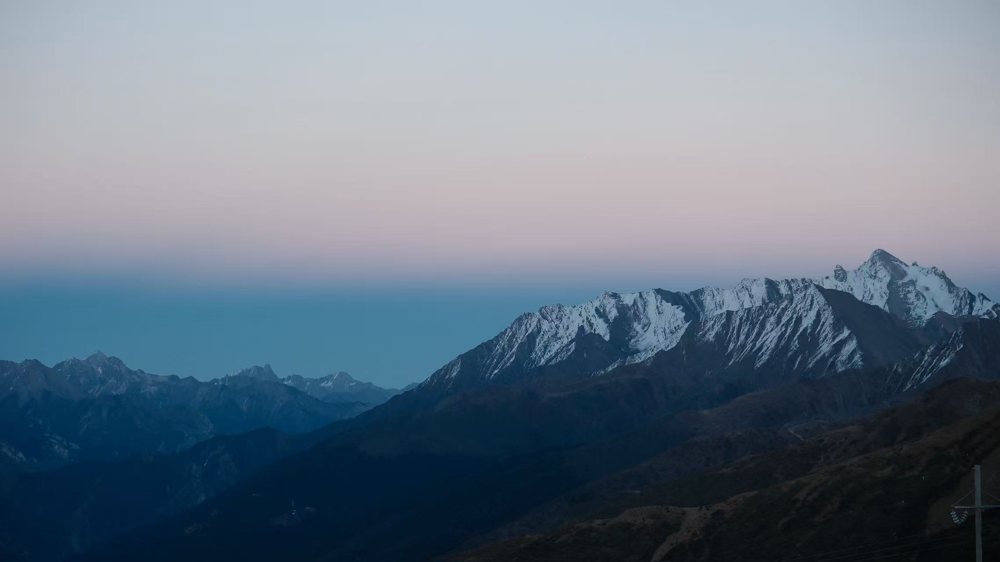
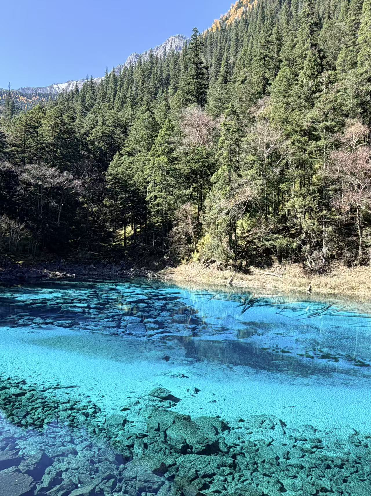
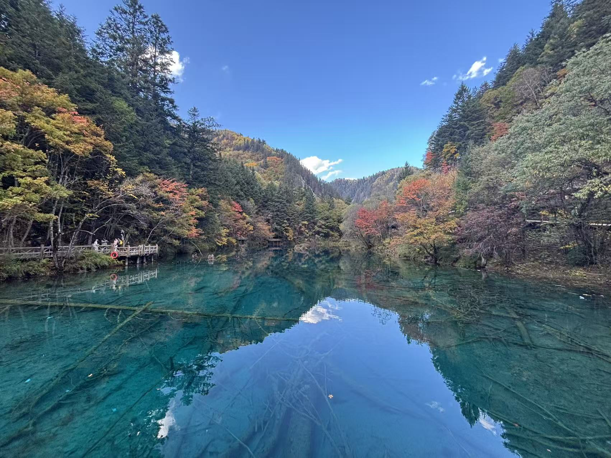
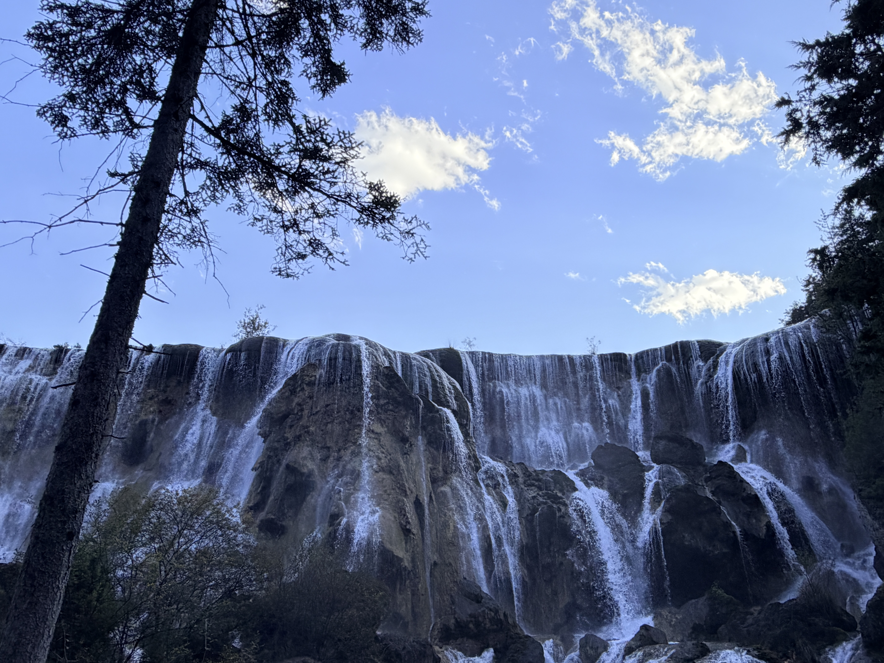
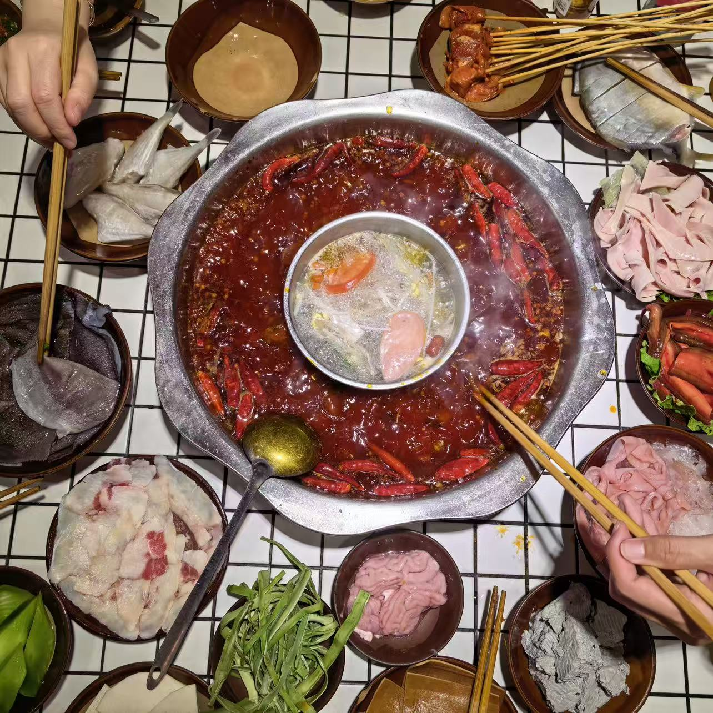

# 启程

公司每年有两天带薪旅游假。去年随便找了个海岛躺了两天，感觉意思不大。今年认真找了九寨沟的团出去玩。10.21 周三下班，立刻就往机场赶。两个小时的飞机，到达成都时已经晚上十点半了。入住酒店，抓紧休息。

# 松潘

10.22 上午从成都东乘高铁到松潘。刚下火车，气象大不相同：云非常低，而且都是大朵大朵的；这边海拔 2900 米左右，午间的阳光猛烈，紫外线强，并且云层薄，要注意防晒——所以这边的人们脸上会有“高原红”。取车之后，自驾去松潘古城觅食。这里牦牛肉烧烤一元一串，肉质比较硬，但味道很赞。午餐在“夏尔巴藏餐”餐厅，吃得很满意。团友们对牦牛酸奶很感兴趣，但它用极致的酸味劝退了大家。我吃了几口反而适应了，想起了在法国的不加糖的原味酸奶。

松州古城，和唐太宗时期松赞干布发动的松州之战以及文成公主和亲有关。现在城门口还矗立着二人的雕像。

下午驱车去往牟尼沟。扎嘎瀑布挺震撼，可惜山里天气并非绝佳。台阶沿着瀑布向上蜿蜒，在三千米海拔上登起来还真有点吃力。小步慢走，终登顶峰。学会了 iPhone 拍摄瀑布拉丝效果：只需要打开实况，拍好后把效果调成“长曝光”。

晚餐牦牛肉火锅，吊龙和卤牛肉吃爽了。总结今日餐食：蛋白质含量丰富。哦对了！第一次吸氧，氧气瓶轻轻的，吸起来基本没啥感觉。可能我高反不是很严重，感觉作用不大。

晚上驱车一个半小时沿山路来到“光和云朵”民宿，有一多半是乌漆嘛黑的乡道，一个人都没有，而且半路开始下雨，我们的远光灯照着前方淅淅沥沥的雨滴，是黑夜里孤独的光源。路上偶尔遇到几头牛马，有的在路边，有的卧在路中央。仿佛来到了寂静岭，很有恐怖气氛。这里民宿环境原生态，代价就是位置偏僻，价格挺贵，三人间一千二一晚。

# 雪宝顶

10.23 今天似乎已经适应了海拔，不会快走两步就气喘。但血氧还是 90 左右。我发现华为手表测量血氧蛮准的，用团友的小米手环测，所有人都是 98%，没有太大参考价值。

上午天气特别好，有空好好欣赏一下民宿周边的自然环境。房间背后就是一条溪流，我们溯溪而上，在森林中漫步。远处是雪山，身侧是湍急的溪流，头顶是蔚蓝天空和大块棉花糖，脚下是松软腐殖质和草地（时不时也有马粪）。民宿老板养了一只哈巴狗，它一直在给我们引路，很有灵性。

民宿的餐厅视野极佳，能远眺远处雪山。餐厅里有一只小馋猫，跳到桌子上来啃玉米。

午餐过后，驱车前往九寨沟。五点半左右到达松潘县城附近，时间正好，地点正好，我们临时起意直接去雪宝顶观景台（这便是自驾游的乐趣所在）！开车行驶在盘山公路，右侧是深邃的峡谷，抬眼便是雪山，再往上是落日熔金下的蓝天白云，心旷神怡。雪宝顶是岷山的主峰，不自禁想到了毛主席的那句：“更喜岷山千里雪，三军过后尽开颜”。在 4000 米海拔的观景台等到日落时分，终于看到了心心念念的日照金山。太阳的余晖洒在雪山峰顶，给皑皑白雪镀上一层金色。（ps: 日出的日落金山，需要站在雪山东面；日落则要站在雪山西面）

晚上接着一个半小时的夜路，走九寨旅游大环线，一路下坡到九寨沟县。经验总结：这种弯多照明差的夜路，跟着一个经验丰富的前车会很舒服，既能帮你领航，也能挡对向车道的远光灯。

# 九寨沟

10.24 非特种兵游玩九寨沟。扎西德勒，纳吉纳鲁！

九点钟到达景区开始排队。大概 20 分钟坐上接驳车。被随机分到左线，那就：长海，启动！左线的上季节海和下季节海顾名思义，水位随季节变化很大。现在水位很低，所以只看长海和五彩池。10:20 到达长海。雪山+湖泊+森林，没有震撼的感觉，可能昨天已经对雪山审美疲劳了。走栈道到达五彩池，蓝绿色的澄清海子，清澈见底。“九寨归来不看水”，果然不是一句空话。

11:40 乘车前往诺日朗中转站。就餐休息，一点半出发前往右线。两点钟到达原始森林，开始 3km 徒步。去天鹅海一路下坡，丝毫不累。而且大家来右线都去熊猫海、箭竹海、五花海那几个海子了，真正上到原始森林的人并不多。这边的徒步风景极美，森林、古木、海子、山光、白云...移步换景，随处出片。光是这一段，九寨沟就不虚此行了。

16:00 坐车下山，跳过箭竹海和熊猫海，直奔五花海。这个时间点光线减弱，但云天山林在五花海中的倒影依旧很绝。
17:00 左右坐车到达珍珠滩瀑布，86版西游记师徒四人涉水而过的取景地。它不是黄果树瀑布那种直落银河的震撼，而是依靠“分布式”取胜：层层叠叠，彼此承托落下。
17:45 乘车下山。途径树正寨其实还可以下车看看五彩花林。但我们讲究一个见好就收，果断出景区。

# 返程

10.25 开始返程。先到松潘站还车。这次租车很成功，车子干净且好开。中午到达松潘，找家路边家常菜馆，五个人 20 分钟风卷残云完成干饭。四川的大葱叶炒腊肉真香，薄薄的腊肉肥而不腻，搭配大葱叶的香味，很下饭。

下午五点半到达重庆江北机场高铁站。距离起飞三小时，时间紧任务重，跑去机场附近的 “夏孃老火锅” 吃了顿地道的重庆火锅。说起来，这家店还真不错，生意火爆的同时，愿意提供预定服务。我们提前点好菜，他们提前备好菜、上锅底、开火煮。我们到店，锅子也沸腾了，直接开始享用。入口先感觉到麻，然后是辣，伴随着香。吃完一顿，嘴唇已经麻掉了。这火锅，吃着不烧心，但有点烧胃。一定要搭配冰粉，在满锅的麻辣鲜香中带来一丝清凉。

说起返程，我还干了一件蠢事。返程航班忘记买行李额了。原本花 100 块 买 20kg，现在 180 块买 10kg 行李。本次航班过后，必须郑重评价：西部航空实乃廉航中的廉航。小板凳座椅我都忍了，毕竟是廉航标配。但座椅前方没有网兜、机上不提供毛毯、严格限制登机箱尺寸，让人大开眼界。规定比民航局的 20 寸更严格，而且登机口的地勤查得很严，如果超过就得交钱“升舱”才行。也可以免费托运，但行李第二天才能到。有急事的人只能捏着鼻子认了。

总结一下这次的四日游：整体的行程安排很合理，景点内松弛，景点间紧凑。旅途前两天有高反症状，后续慢慢适应了。10 月底的九寨沟气温已经很低，我特意穿了带羽绒的三合一冲锋衣，里面还要加一件秋衣才行。行程前准备了一些常备药，没有用上，但总是有备无患。九寨沟值得再去一次，瑞思拜！
