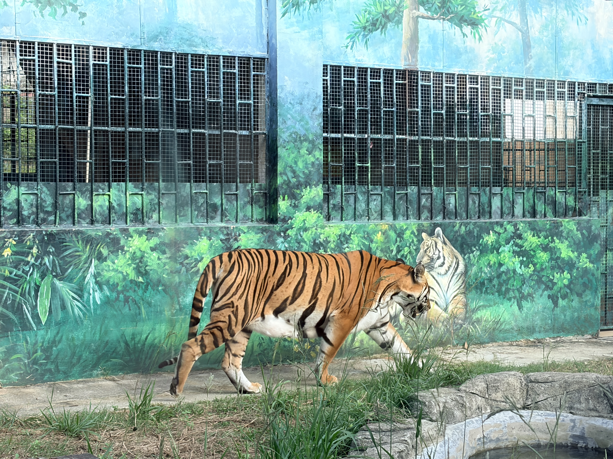

周末去韶关国家森林公园玩，里面有一个动物园，人不多，30 块门票也很便宜。这里繁育了十几只华南虎，老虎很喜欢在玻璃前踱步，因此游客获得了和老虎近距离合影的机会。还有其他动物：非洲鸵鸟、鸸鹋（也就是澳洲鸵鸟）、卡皮巴拉、鳄鱼、黑山羊（山羊胡子很好玩）、羊驼、短尾猴、梅花鹿、黑熊...还有十几种耳熟能详的动物。

但紫薇看到了动物的精神状态普遍不好，而且有些动物会反复踱步的刻板行为。也是，整天在笼子里关着，谁的精神能好？

这里是华南虎繁育基地，所以能靠着补贴养活这么多种动物。但养活是一方面，圈块地把这些自由的生命关一辈子，只为了"让人看一眼"或者"让孩子认识动物"，人真的有这个权利吗？进一步联想，有些父母对孩子构成了类似的权力结构：一方拥有绝对支配权，另一方没有退出机制。父母提供物质基础和庇护所，严格要求孩子在自己规定的框架内生活。久而久之，孩子难保不会像反复踱步的动物一样，出现叛逆、讨好等适应性行为。
“天下之事，难就难在你中有我、我中有你”。很难隔离，甚至很难察觉。
